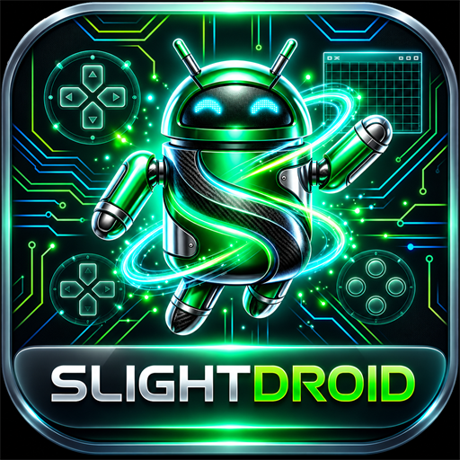

<p align="center"></p>

# SlightDroid

A lightweight Android emulator for Windows, packaged as one offline installer. It runs
Android 11 (x86_64) with hardware virtualization (Windows Hypervisor Platform) and GPU
acceleration, resumes in seconds, and plays video smoothly, including web-based players.
No ads, no store, no analytics.

**Target hardware:** low-end PCs (4 GB RAM, Intel Pentium, integrated graphics). The dev PC is
only a proxy; see [docs/PLAN.md](docs/PLAN.md) for the original plan and budgets.

> **Status: v0.1.0 alpha, tested only on the dev PC.** Not yet run on a real 4 GB / Pentium PC.
> Read [Licensing](#licensing) before sharing an installer: the current build bundles
> Google binaries that are not redistributable.

## What it does

| Area | Behaviour |
|---|---|
| Engine | Google's Android Emulator (37.2.13) running the AOSP Android 11 x86_64 image, accelerated by Windows Hypervisor Platform (WHPX). Rendering on the PC's GPU; software rendering when the PC has no real GPU. |
| Start-up | First start ~50 s; after that Android resumes from a quick-boot snapshot in ~2-4 s. Closing saves the snapshot. Loading screen with a real percentage. |
| Resources | Shares the PC with Windows: Android gets what is free minus a reserve for Windows and the engine, at most half the PC's RAM (1-4 GB) and half its CPU threads (2-8). Overridable in Settings. |
| Display | Resolution follows the monitor's shape, at most 800 lines with a GPU (720 without). Window fitted to the screen, pixel-exact at any Windows scaling. **F11** or Ctrl+Alt+F: full screen. |
| Video | In-app web video: the engine's per-command graphics checksum is off (NetMirror hitches 8.2 % -> 0.4 %), and a current WebView (108) replaces Android 11's WebView 83 at first start. Native players (VLC) play 1080p30/60 H.264 and HEVC smoothly. |
| Apps and files | Drag an APK onto the Android window to install it; other files land in Download. Double-click `.apk` files in Windows. **SlightDroid Files**: browse Android storage, drag files in and out, Ctrl+C / Ctrl+V with Explorer, rename, delete. |
| Controls | The engine's side toolbar (power, volume, rotate, back/home/recents, screenshot, more) and keys: Ctrl+H home, Ctrl+Backspace or Esc back, Ctrl+O recents, Ctrl+P power, Ctrl+= / Ctrl+- volume, Ctrl+S screenshot. |
| Privacy | `-no-metrics` (no usage statistics to Google); crash uploaders removed from the engine. |

## Using it

1. Run `SlightDroid-Setup.exe` (64-bit Windows 10 1809+ or 11). Setup checks the PC, offers to turn
   on Windows Hypervisor Platform if needed (restart), or explains the BIOS setting.
2. Start **SlightDroid**. Tray icon: Show, Full screen, Install app, Files, Settings, Stop.
3. **SlightDroid Settings**: Android memory, CPU cores, graphics, resolution (auto, presets, custom),
   density, window (fit, actual size, full screen), storage (50 GB minimum, sparse).

Data lives in `%LOCALAPPDATA%\SlightDroid` (virtual device, snapshot, logs). Uninstall asks before
deleting it.

## Project layout

```
launcher/            SlightDroid.exe: C# 5 / .NET Framework (built with the csc.exe that ships with Windows)
  Program.cs         start / stop / install / files / settings entry points
  Vm.cs              engine start (device config, ports, console stop), GPU mode, WebView update
  Config.cs          settings.ini, RAM/CPU sharing rules, GPU detection, resolution
  Session.cs         tray icon, window name/icon, full screen hotkey
  FullScreen.cs      full screen for the engine window
  BootSplash.cs      loading screen with progress
  FilesForm.cs       Windows <-> Android file manager (own ADB sync client)
  SettingsForm.cs    settings window
  Adb.cs             minimal ADB protocol client (shell, install, sync)
installer/           SlightDroid.nsi (NSIS), icons, NOTICE
tools/
  envcheck/          PC check (WHPX, BIOS virtualization, RAM, GPU, video decode)
  fetch/             deps.json + fetch-deps.ps1: pinned, checksum-verified downloads
  build/             setup-build, staging, installer build, WebView rename, test and benchmark scripts
  diag/              diagnostics zip for bug reports
guest/lite/          Android-x86 9 overlay (earlier QEMU engine, kept for reference)
docs/                plan, logo
```

## Building

### What you need

- Windows 10/11, 64-bit. PowerShell 5.1, `curl.exe`, `msiexec` and the C# compiler used for the
  launcher all ship with Windows.
- **Python 3.8+** ([python.org](https://www.python.org/downloads/)).
- **Android Studio** (or the Android SDK **build-tools** plus a Java 17+ runtime): `zipalign`,
  `apksigner` and Java sign the WebView update. In Android Studio: SDK Manager > SDK Tools >
  Android SDK Build-Tools.
- About **1.3 GB of downloads** and **15 GB of free disk space**.
- To run and test it: CPU virtualization enabled in the BIOS and Windows Hypervisor Platform on
  (`tools/envcheck/envcheck.cmd` checks both).

The build installs nothing on the PC; everything stays under `downloads/` and `build/`.

### Steps

```powershell
powershell -NoProfile -ExecutionPolicy Bypass -File tools/build/setup-build.ps1
```

```powershell
powershell -NoProfile -ExecutionPolicy Bypass -File tools/build/stage-engine.ps1
```

```powershell
powershell -NoProfile -ExecutionPolicy Bypass -File tools/build/build-installer.ps1
```

1. `setup-build.ps1` (once): downloads the pinned inputs from `tools/fetch/deps.json` (segmented,
   resumable, checksum-verified; rerun it to resume), unpacks portable NSIS, 7-Zip and adb into
   `build/tools`, and finds the Android SDK build-tools, Java and Python. Paths it cannot find can
   be given with `-Sdk`, `-JavaHome` and `-Python`. The result is `build/tools/toolpaths.json`.
2. `stage-engine.ps1` assembles `build/payload`: the engine (x86_64 only; other CPU types,
   network simulator and crash uploaders removed), adb, the Android 11 image (split into 1 GB
   parts for the installer), WebView 108, `SlightDroid.exe`, tools and licences. The WebView is
   Bromite's `x64_SystemWebView.apk` (release 108.0.5359.156), renamed to `com.android.webview`
   by `tools/build/rename-webview.py` and signed with the public AOSP test key.
3. `build-installer.ps1` runs portable NSIS and writes `dist/SlightDroid-Setup-<version>.exe` plus a
   `.sha256` (progress window with ETA, about 20 minutes).

### Run it

Without installing (straight from the build, after step 2):

```powershell
powershell -NoProfile -ExecutionPolicy Bypass -File tools/build/run-portable.ps1
```

The first run joins the Android image (about 3 GB, once) and boots Android in about a minute;
later runs resume in seconds. Android's data stays in `build/run-data`. Stop it from the tray
icon, or run the same script with `-Stop`.

Or install it like a user would: run `dist/SlightDroid-Setup-<version>.exe` from step 3.

Both need CPU virtualization enabled in the BIOS and Windows Hypervisor Platform turned on;
`tools/envcheck/envcheck.cmd` checks this and explains what to change.

`tools/fetch/fetch-deps.ps1 -All` also fetches the packages of the earlier QEMU engine
(QEMU, Android-x86 9, BlissOS, a VLC test APK; about 2.5 GB), which the current build does not use.

Test helpers (portable, separate data folder via `SLIGHTDROID_DATA`): `engine-test.ps1` (start, stop,
resume), `gpu-bench.ps1` (scroll jank per resolution), `webview-video-bench.ps1`; `freeze-test.ps1`
and `balloon-test.ps1` are from the earlier QEMU engine.

## Measurements (dev PC proxy: Ryzen 7, 16 GB, RTX 4050, Windows 11)

| What | Result |
|---|---|
| First boot / resume | 47-57 s / 2-4 s |
| Scrolling (Settings app) | 0 % late frames at 1280x800 and 1608x1008 |
| VLC 1080p30 / 1080p60 H.264, 1080p30 HEVC | 30.2 / 60.5 / 30.2 fps; 3 / 0 / 0 late frames of 126 |
| NetMirror (WebView video), frames held >= 58 ms | 8.2 % before, **0.4 %** with checksum off and WebView 108 |
| Engine memory | about 0.7-0.9 GB on top of Android's RAM |

Nothing has been measured on target hardware yet.

## Known issues

1. **Licensing** of the bundled Google binaries (see below): installers may not be shared yet.
2. **Untested on low-end PCs.** On a 4 GB PC Android gets about 1-1.25 GB; whether Android 11 is
   comfortable there is unknown.
3. **ARM-only apps don't install** (the AOSP image has no ARM translation).
4. **No browser app** in the image (WebView is there; a browser APK is planned).
5. **WebView 108 is unmaintained** (Bromite ended in 2022): newer than the image's 83, but without
   security updates.
6. Keyboard shortcuts are the engine's own and cannot be remapped yet.
7. The installer is unsigned, so SmartScreen warns ("More info" > "Run anyway").
8. Shrinking Android's memory while it runs does not return RAM to Windows (measured with the
   virtio balloon), so RAM is sized at start.

## Licensing

SlightDroid's own code: [MIT](LICENSE). Third-party components and what may be
redistributed: [LICENSES.md](LICENSES.md). The source in this repository is fine to publish:
no third-party binaries, APKs or Android images are committed. **The installer, however,
bundles Google's emulator, platform-tools and Android 11 system image, which come under the
Android SDK License (not redistributable).** Sharing installers needs those replaced by builds
from AOSP source or another redistributable image.
